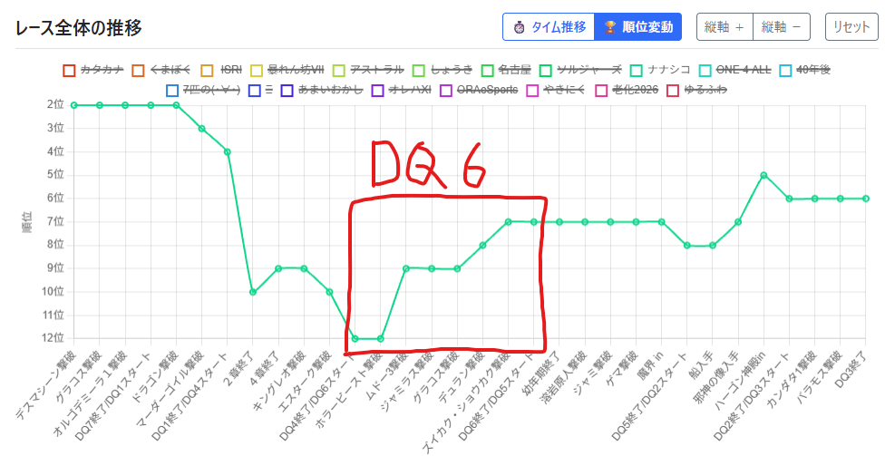

# 第18回身内メンツでDQRTA7作リレー プレイレポート
# [SFC版DQ6 Any% RTA in 7:13:36](https://www.twitch.tv/videos/2898021475 ) by みるきぃ

- プレイ日時: 2026年10月10日～11日
- 計測区間: 本体の電源投入からTHE ENDの羽ペン消滅まで
- 使用したバグ(？)技:
  - 装備技
- 使用ソフト: 通常ソフト(G741812 SHVC-JPN-1 刻印12)
- 使用本体: SFC
- 使用コントローラ: アスキーパッド、連射機能使用
  - 設定: B,Y,L,Rボタン手動連射
- 最終レベル: ドランゴ7 ハッサン26 テリー26 チャモロ24 主人公25 アモス24 ミレーユ24 バーバラ20
  - メタルスライム: 1匹 (アモール北の洞窟)
  - メタルキング: 1匹
----

## タイム

|区間名|通過|区間|備考|
|:---:|:---:|:---:|:---:|
|電源投入|00:00:00|||
|とうのへいたい撃破|00:23:43|00:23:43||
|ブラディーポ撃破|00:49:15|00:25:32|夢見道中全滅2回|
|ホラービースト撃破|01:07:57|00:18:42|主人公乙1回。メタスラ狩り|
|ラーの鏡入手|01:23:56|00:15:59||
|ムドー1撃破|01:34:53|00:10:57||
|聖域in|01:49:48|00:14:55||
|ムドー3撃破|02:23:43|00:33:55|城内乙1回、ムド3乙1回|
|アークボルトin|02:54:00|00:30:17|途中からレイドック周辺稼ぎ|
|ブラスト撃破|03:01:53|00:07:53||
|ジャミラス撃破|03:17:09|00:15:16|ルカニ0|
|しれんその3撃破|03:34:01|00:16:52||
|ミラルゴ撃破|03:57:53|00:23:52|仲間呼び1回、ベギラゴン2回|
|スフィーダの盾入手|04:17:55|00:20:02||
|グラコス撃破|04:34:53|00:16:58||
|まおうのつかい撃破|05:06:13|00:31:20||
|デュラン撃破|05:27:37|00:21:24|最終Tにハッサン乙|
|なげきのきょじん撃破|05:52:51|00:25:14||
|アクバー撃破|06:05:00|00:12:09||
|ズイカク・ショウカク撃破|06:18:31|00:13:31|ドランゴ乙|
|デスタムーア戦in|06:38:29|00:19:58|19エンカ、メタキン1+ずしおうまる3狩り|
|デスタムーア撃破|06:52:29|00:14:00||
|The End|07:13:36|00:21:07||

- 計測地点:
  - ～in: 建物に触れた瞬間
  - ～撃破:戦闘終了後、暗転した瞬間

## 順位変動

https://ochakirin.github.io/miuchi-ranking/ から、自チームの順位のみを折れ線グラフで表示

**右肩上がりで良いね！**

## 実際のプレイについて

### 開始前
- リレー形式でDQ6は4番手、7リマ→1リマ→4→6の順だった。自分のあとにも5，2，3が控えていたので大きくこけないようなプレイを心がけようと思っていた。
- プレイ当時はよく分かっていなかったが、6開始時点での順位はどうやら19チーム中12位だったらしい。
- トップや2位集団のチームとは1時間近くの差があったため全く追いつける気はせず気楽ではあった。
- どこかのチームの誰かさんが(大会では禁止されている)マクロ機能を使っている疑惑が話題になっていたのでマクロン大統領の画像を用意したが、その関連性に気づいてくれた視聴者は少なかったらしい。
  - テキストは『「マクロ」ン大統領』にした方が良かったかな…と反省。でもミラーでは結構面白がってくれて盛り上がったみたいなのでそれはそれでよかった。

### 開始～ムドー3撃破まで
- OP終了でマクロン大統領の画像を消す。ミラーではムドーに消されたことになってた。良い解釈だ。
- 夢見の洞窟「ベビーゴイル*3+スライムナイト」エンカで全滅。2逃げミスでギラ3回は強すぎ。
  - 夢見全滅でのリカバリを分かっておらず、主人公単騎で再突入するも「ベビーゴイル*2+スライムナイト」に殺される。
  - おとなしくハッサンを蘇生+セーブして再々突入。
  - お金が心配だったので夢見B2Fの230Gをこの時点で回収。アドリブだったが、取らなかったらレイドックでお金が足りなくなっていたので正解だった。
  - ブラディーポはすぐいなくなってくれた。
- アモ北洞窟1エンカ目「ベビーゴイル*3」に2逃げミスで主人公死亡。アモールまで戻って主人公を蘇生。
  - 再突入後の1エンカ目「メタルスライム+ベビーゴイル*2」でメタスラを倒すことに成功。この戦闘でもギラで殺されかけたが何とか切り抜ける。
- 地底魔城エンカがデレ、ムドー1が非常に弱かったおかげで11位に浮上
- 精霊の鎧購入後のムドー城突入1回目、「カメレオンマン*3」エンカで4逃げミスしミレーユが死亡しデスル。隊列を4番目にすべきだったかもしれないが4逃げミスはさすがにケアしたくない。
- 再突入後のムドー2戦、お供を呼ばれまくり2092expゲット。嬉しくないが。
- ムドー3戦、1T目にデスコン(氷+稲妻)でHP89の主人公が落ち、驚異の34秒で1戦目は終戦。[クリップ](https://www.twitch.tv/gagamilky/clip/IntelligentProtectiveTortoiseTakeNRG-NpiQg2D_Hy6HoW4X )
  - 精霊の鎧装備の主人公に対してデスコンはダメージ乱数が71～91なので、かなり高乱数を引いてしまった形。デスコンが1/8であることを考えると相当薄いのを引いてしまった。これが本番の魔物か。
- なんか周囲の順位の人たちもムドーで死にまくっているという情報をコメントで教えてもらいつつムドー2再戦。今度は1471exp。
- ムドー3再戦、順調に削っていたものの、ムドー残HP256の時点で光or睡眠TにHP53のチャモロが後行(6%)して氷まで回ってチャモロが死亡。は？
  - 残HP177、主ハのみの氷TでHP74の主人公に防御をさせる判断は良かった。デスコンがきたので防御してなかったら負けていた。
  - 残HP91の氷Tでハッサンが攻撃するかゲント振るか迷って攻撃したが爪乱数が低めで倒せず。結果的に主ハどちらも生存して次T撃破したが、これはおとなしくゲント振って爪2回で倒しに行くべきだった。ゲントを振らない場合、デスコンからの次T氷まで回って全滅する可能性があるため。ハッサンが攻撃していいのはハッサンの攻撃で確実に倒せる場合のみだろう。
- ムドー3撃破時点で順位は9位まで浮上していたが、ムドー乙がなかったチームくまぼくのるるりゅーさんには逆に抜かされており、結局このチームとはここからEDまで並走し続けることになる。

### デュランまで
- メタスラ狩り+ムドー3で1乙していたので、熟練度稼ぎでハッサンがLv15になってサンマリーノ周辺で熟練度を得られなくなる事態が予想された。
  - 電卓をたたいて経験値を計算し、Lv15になる直前でレイドックに稼ぎ場所を変更。途中で戦闘回数を1回分数え間違えたせいで余分に1回戦闘してしまう。が、そのミスのおかげで後々助かることになる。
- ジャミラス戦、ルカニ(50％有効)が2T連続で効かなかった挙句、炎炎打撃で主人公が3T目に死亡。だるいジャミラス戦が始まる。
  - 不幸中の幸いでミレーユが落ちず、ほぼかまいたちを撃ち続けてくれたおかげでルカニ0の割には悪くないタイムでジャミラス戦を突破。ありがとうミレーユ。
- 魔術師の塔、雑魚エンカは3回全て1逃げ、ミラルゴは仲間呼び1回ベギラゴン2回とかなり弱かった。こんなに良い魔術師の塔はなかなかない。
- 不思議な洞窟で「ドラゴンソルジャー*3」に2逃げミスでハッサンアモス死亡。ザオラル成功(2/4)でなんとか事なきを得る。これがドラクエソルジャーズですか？
- 海底神殿も無事に抜けるが、グラコス戦で正拳のダメージが明らかに低く、力の種を天馬の塔で追加で入手することを考える。
- ライフコッド連戦、無事にバーバラ生存で切り抜ける。
- ヘルクラウド戦は1T目にルカニ(50％)が主バどちらも入ったので早い。
- キラーマジンガ+ランドアーマー戦、ランドアーマーの混乱が解けてしまった後にもう一度星のかけらで混乱を入れに行ったが2回外してしまう。
  - 混乱が入るのを待つ間主人公はずっと気合ためをしていたが、よく考えればマジンガに攻撃する場合とは異なり仁王立ちはされてもよいのだから混乱が入るのを待つ必要はなかった。
- デュラン戦、残HP638のTに気合諸刃+マダンテで倒そうとしたが諸刃のダメージが318と下振れてしまい、次Tに87も残ってしまう。挙句、このターンに波動を撃たれたために次Tにムーンサルト+突き刺しでハッサンが落ちてしまう。
  - なお、次Tに撃ったアモスの炎爪は87ダメージ出ていたため先制していれば倒せたやんけ！となる。
  - ハッサンにデュランの経験値が入らなかったため、メタキン狩り後のハッサンのレベルが25になることが予想された。ただ、本来1回分少なくなるはずの熟練度は余分に稼いでいたおかげで考えなくて済んだ。
- ムドー3撃破～デュラン撃破までは全体的にエンカやボス運に恵まれ、ムドー3撃破時点では5分くらい負けていたチームくまぼくも追い抜き順位は8位に浮上。

### EDまで
- ハッサンの力の値が心配だったので、本来は取らない天馬の塔の最上階にある力の種を回収。結果的にどこまで役に立った(タイムを回収できた)かは分からないが、安心感はもらえたので良いと思っている。
- 裏世界に入ってからはエンカ運が悪く、賢者の湖で1エンカ3逃げミスしたり、普段エンカのない賢者の湖～牢獄の町道中で「動く石像*3」襲い掛かりなどを引いてしまう。
- トンヌラから貰う力の種4つの値が「3/3/2/1」だったおかげで一安心する。天馬の塔回収分も合わせて平均値くらいにはなっているだろうと考える。
- アクバー戦は星かけの混乱(50%)がガーディアンに入り、アクバーもルカニ(50%)やマホトーン(50%)がちゃんと効いてくれたおかげで楽勝。
- 苦手意識のあるズイカクショウカクにはしばかれてしまう。
  - 1T目にズイカク主人公殴りで2T目にルカニを撃てなくなる
  - 岩石落としTにドランゴHP63となってしまい、主のゲント先行(80％)に甘えた結果後行してドランゴ落ち。乱数次第では落ちるけどさすがに防御させるべきだった気がする。
  - とはいえハッサンの正拳が全部当たったため意外と早く倒せた。
- メタキン狩り17エンカ目「メタキン2+ヘルクラッシャー1」で時砂を使わず1体撃破。ハッサンが25、チャモロが23までしか上がっていなかったのを確認して追加でエンカを取ることに。
  - 19エンカ目「ずしおうまる*3」戸惑いエンカを狩ってハッサン26、チャモロ24を確認。ちょっと遅いけど砂は使ってないし最低限か、くらいに思っていた。
- 道具管理には自信があったので最終確認もせずにムーアin
- 第1形態、ドランゴが金槌(3/8)をかなり当ててくれたが敵の行動も強く、念じボール2連+炎でハッサンが落とされる。雫も切らされ、チャモロが落ちている状態で第2へ。時間自体は3分程度
- 第2形態はかなり優しく、スカラが遅めだったうえに1回も死人が出ずに4分ほどで撃破。
- 第3形態は可もなく不可もなくといった感じで、気合バイキル正拳は許してくれないけどマダンテは撃たせてくれたり、睡眠は毎回ハッサンに飛ぶけどBローテの動きは優しかったり。
  - ただ第3形態はドランゴが全然当てなかった(0発)ので少し遅く、7分ほどかかって撃破。合計14分ムーア。
- ED、最後にもう一回マクロン大統領を映して終了。チームの順位は7位になっていた。

## 全体を通しての感想
- ムドー3撃破が2:23:43でムドー後4:49:53 と、後半がとても良い走りになった。
- 明確に人災で無駄にしたと言えるのは夢見全滅後のムーブの2分ほど。ほかは細かいところで、自分の出せる実力は全部出し切れたと思う。
- 単純に6をそこまでガッツリはやっていないのでリカバリ経験が少なく、イレギュラーへの対応力がまだまだ足りていないのは課題。
- 区間順位としては恐らく4位。今回DQ6走者のレベルが高めで7時間台前半を当然のように出してくるプレイヤーばかりの中でここまでやれたのは自信につながった。

## 謝辞
- [peach](https://x.com/peach_rta )さん
  - チャートぱくりました(自白)。この借りはどこかで。
- [すなに](https://x.com/sna_nico )さん
  - 身内で６やるたびにあれ教えてこれ教えてとメッセージを送り、そのたびに快く助言をくださってとてもとても助かっております。
  - 今回も教えてもらったことが活きた展開が数多くありました。世界最速の有識者としてこれからも頼りにさせてもらえたら嬉しいです。いつも本当にありがとう！
- [運営](https://x.com/DQmiuchi )の皆さん
  - 今回も運営大変お疲れ様でした&ありがとうございました。
  - 18回もこんなことやってんのやばいっすよ（誉め言葉）
- 「ドラナナシコ×2」チームメイトのみんな 
[たなか](https://x.com/TNKTNKDQ )
[TEE](https://x.com/tee_DQ )
[あんぱん](https://x.com/Ann_pan1227 )
[奴隷先輩](https://x.com/drisnpi )
[みすち](https://x.com/mrmisuchiru )
[Rou](https://x.com/rou_2525 ) (出走順)
  - まずはチームを組んでくれてありがとう！
  - 今回はメンバーがなかなか揃わず出られるかどうかという所から始まったけど、めちゃくちゃいいメンバーが集まりましたね。交代とかもなかったし。
  - 2018年第11回大会、初代Teamドラナナからの付き合いの長いおじさん達もいれば、今回初めてチームになった若人もいてとても良いバランスのチームだったんじゃないかなと思います。
  - 本番での走りについては各々反省とか後悔とかあると思うけど、第一にタスキを最後までつなげて完走できて良かった。総合順位も6位なら悪くないでしょう！
  - これからも末永く仲良くしてやってください。いったんお疲れさまでした！

応援してくれた方、見てくれた方もありがとう！
ドラナナシコ×2をこれからもよろしくお願いします！
